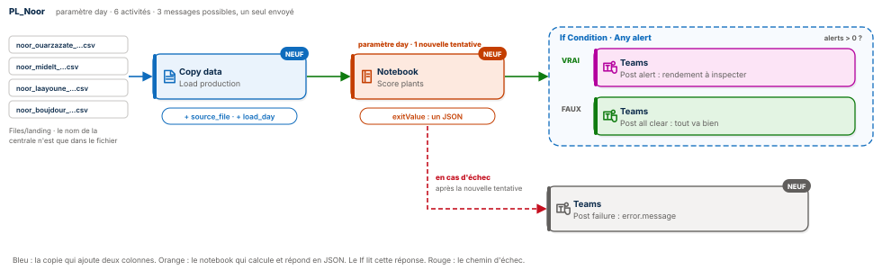
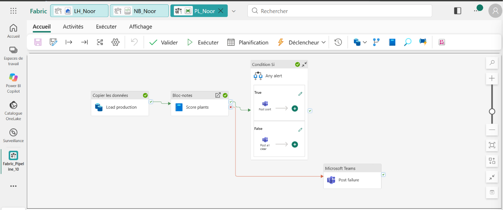
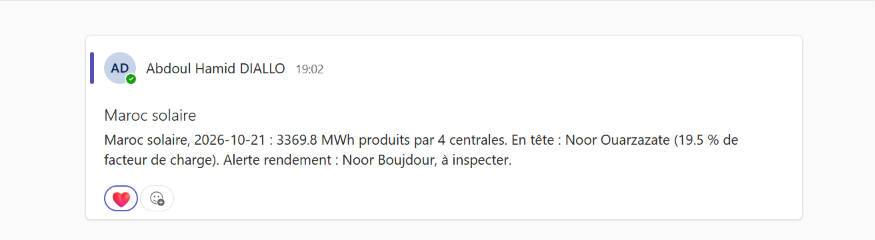
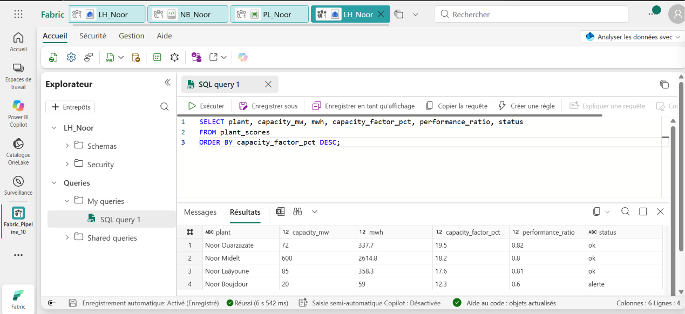
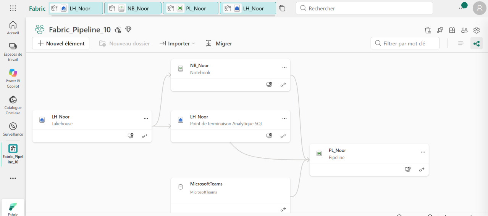

# ☀️ Fabric Pipeline Express 10 : une copie qui étiquette, un notebook qui répond




Un pipeline Microsoft Fabric Data Factory qui surveille quatre centrales solaires marocaines du complexe Noor : Ouarzazate, Midelt, Laâyoune et Boujdour. Une seule copie charge leurs quatre fichiers horaires et grave dans chaque ligne le fichier d'où elle vient. Un notebook paramétré classe les centrales, écrit le résultat dans le lakehouse et renvoie son verdict au pipeline en JSON. Le pipeline lit ce verdict pour choisir le bon message Teams, et prévient avec la cause exacte si le calcul échoue.

**Guide PDF de 7 pages inclus** : [`Pipeline_Fabric_Guide_10_public.pdf`](Pipeline_Fabric_Guide_10_public.pdf). Chaque activité, chaque réglage, chaque expression, et les chiffres à retrouver à l'unité près. Les valeurs à copier sont dans [`data/expressions.txt`](data/expressions.txt) et le notebook, prêt à importer, dans [`notebook/NB_Noor.ipynb`](notebook/NB_Noor.ipynb).

## 📸 Aperçu

`PL_Noor` après une exécution réussie : la copie, le notebook, la condition Si avec ses deux messages, et la flèche rouge qui ne s'allume qu'en cas d'échec.



Le message publié dans Microsoft Teams, construit à partir du JSON renvoyé par le notebook.



La table `plant_scores` interrogée dans le point de terminaison SQL du lakehouse : la production, le facteur de charge, le rendement et le statut de chaque centrale.



## 🎯 Résultats clés

| Indicateur | Valeur |
|---|---|
| Activités | 6 (Copy data, Notebook, If Condition, Microsoft Teams ×3) |
| Nouveautés | Colonnes supplémentaires `$$FILEPATH`, notebook paramétré, valeur de sortie `exitValue` lue avec `json()`, nouvelle tentative, chemin d'échec avec `error.message` |
| Fichiers chargés par une seule copie | 4, soit 96 relevés horaires |
| Énergie produite le 21 octobre 2026 | 3 369,8 MWh |
| Centrale en tête | Noor Ouarzazate, 19,5 % de facteur de charge |
| Part de Noor Midelt dans la production | 78 % |
| Centrale en alerte | Noor Boujdour, rendement de 0,60 pour un seuil de 0,75 |
| Messages possibles | 3, un seul envoyé à chaque exécution |

## 💼 Impact métier

Une centrale solaire peut produire moins pour deux raisons très différentes : parce que le soleil manque, ou parce que les panneaux perdent quelque chose. Le facteur de charge ne fait pas la différence ; le rendement (performance ratio), si. En le calculant chaque jour à partir du soleil réellement reçu, le pipeline isole Boujdour, dont les panneaux encrassés par le vent de sable ne transforment plus que 60 % de ce que le soleil permettait. L'équipe de maintenance reçoit le nom de la centrale à inspecter, pas un tableau à décrypter.

## 📝 Résumé

`PL_Noor` reçoit un paramètre `day`. Un Copy data lit `Files/landing/*.csv` dans le lakehouse `LH_Noor` et écrit la table `production_raw`, en ajoutant deux colonnes à chaque ligne : `source_file`, le chemin du fichier d'origine (`$$FILEPATH`), et `load_day`, le jour traité. Une activité Notebook lance `NB_Noor` avec ce même `day` en paramètre de base et une nouvelle tentative. Le notebook retrouve la centrale dans `source_file`, calcule production, facteur de charge et rendement, écrit `plant_scores` et termine par `notebookutils.notebook.exit()` avec un JSON. Une condition Si lit `alerts` dans ce JSON et envoie l'alerte ou le message rassurant. Si le notebook échoue malgré la nouvelle tentative, la flèche rouge publie la cause exacte.

## 🔁 Pipeline

| Activité | Type | Rôle |
|---|---|---|
| `Load production` | Copy data | `landing/*.csv` vers `production_raw`, action Remplacer, colonnes supplémentaires `source_file` et `load_day` |
| `Score plants` | Notebook | `NB_Noor`, paramètre de base `day`, 1 nouvelle tentative après 30 s |
| `Any alert` | If Condition | `@greater(json(activity('Score plants').output.result.exitValue).alerts, 0)` |
| `Post alert` | Microsoft Teams | Branche Vrai : la centrale à inspecter |
| `Post all clear` | Microsoft Teams | Branche Faux : toutes les centrales au-dessus du seuil |
| `Post failure` | Microsoft Teams | Flèche rouge depuis `Score plants` : `@{activity('Score plants').error.message}` |

## 🧠 Les quatre idées du projet

**Étiqueter à la source.** Le nom de la centrale n'existe que dans le nom du fichier. La colonne supplémentaire `$$FILEPATH` le grave dans chaque ligne : une seule copie suffit pour tout le dossier, et chaque ligne garde la trace de son origine.

**Un notebook qui répond.** Le notebook ne se contente pas de réussir : il rend un JSON. Le pipeline le lit avec `json(...exitValue)` et s'en sert comme d'une table : `.alerts`, `.best`, `.total_mwh`.

**Décider avec la donnée.** La condition Si choisit le message à partir de ce que le calcul a trouvé. Une seule branche part, l'autre reste ignorée.

**Échouer proprement.** Une nouvelle tentative absorbe les incidents passagers. Si l'échec persiste, la flèche rouge prévient avec le message d'erreur du notebook. Le guide la teste exprès avec une date invalide.

## 🚦 Le pipeline en une image

| Étape | Dans un laboratoire d'analyses | Dans Fabric |
|---|---|---|
| 1 | L'accueil reçoit tous les tubes et colle sur chacun l'étiquette de son patient | Copy data avec `$$FILEPATH` |
| 2 | L'analyste reçoit la date et calcule les résultats | Notebook paramétré |
| 3 | Il remplit une fiche de synthèse | `notebook.exit` avec un JSON |
| 4 | Le médecin lit la fiche et choisit quoi dire | If Condition |
| 5 | L'alarme sonne si l'analyse échoue, avec la cause | Flèche rouge et `error.message` |

## 🧬 Traçabilité

```
LH_Noor / Files / landing
   ├─ noor_ouarzazate_2026-10-21.csv ┐
   ├─ noor_midelt_2026-10-21.csv     │  Copy data Load production
   ├─ noor_laayoune_2026-10-21.csv   ├─▶ + source_file ($$FILEPATH) + load_day (@pipeline().parameters.day)
   └─ noor_boujdour_2026-10-21.csv   ┘
                                         ▼
                        production_raw   96 lignes
                                         │  Notebook Score plants (day = 2026-10-21)
                                         ▼
                        NB_Noor : regexp_extract(source_file) ▶ centrale · production · facteur de charge · rendement
                           ├─▶ plant_scores   4 lignes
                           └─▶ exitValue      {"total_mwh": 3369.8, "best": "Noor Ouarzazate", "alerts": 1, ...}
                                         ▼
If Condition Any alert (alerts > 0)
   ├─ Vrai ──▶ Teams Post alert      « … Alerte rendement : Noor Boujdour, à inspecter. »
   └─ Faux ──▶ Teams Post all clear
Échec de Score plants ──▶ Teams Post failure   « … Cause : <error.message> »
```

## 🏗️ Architecture

| Objet Fabric | Type | Rôle |
|---|---|---|
| `LH_Noor` | Lakehouse | Reçoit les CSV dans `Files/landing`, porte `production_raw` et `plant_scores` |
| `NB_Noor` | Notebook | Cellule de paramètres `day`, calcul PySpark, réponse JSON |
| `PL_Noor` | Pipeline | Orchestre la copie, le notebook, la décision et les trois messages |

Le lignage de l'espace de travail : le lakehouse alimente le notebook et le pipeline, qui s'appuie aussi sur la connexion Microsoft Teams.



Le cœur du notebook, qui retrouve la centrale dans le chemin du fichier puis calcule les deux indicateurs :

```python
raw = (spark.read.table("production_raw")
       .filter(F.col("load_day") == day)
       .withColumn("code", F.regexp_extract("source_file", r"(noor_[a-z]+)", 1))
       .withColumn("mwh", F.col("mwh").cast("double"))
       .withColumn("ghi", F.col("ghi_wm2").cast("double")))

scores = (raw.groupBy("code")
          .agg(F.round(F.sum("mwh"), 1).alias("mwh"), F.sum("ghi").alias("ghi_wh"))
          .join(ref, "code")
          .withColumn("capacity_factor_pct", F.round(100 * F.col("mwh") / (F.col("capacity_mw") * 24), 1))
          .withColumn("performance_ratio", F.round(F.col("mwh") / (F.col("capacity_mw") * F.col("ghi_wh") / 1000), 2))
          .withColumn("status", F.when(F.col("performance_ratio") < 0.75, "alerte").otherwise("ok")))
```

Le facteur de charge compare l'énergie du jour à ce que la centrale produirait à pleine puissance pendant 24 heures. Le rendement la compare à ce que le soleil reçu permettait : c'est lui qui révèle des panneaux encrassés.

## 📊 Résultat final

```sql
SELECT plant, capacity_mw, mwh, capacity_factor_pct, performance_ratio, status
FROM plant_scores
ORDER BY capacity_factor_pct DESC;
```

| Centrale | Puissance retenue | Production | Facteur de charge | Rendement | Statut |
|---|---|---|---|---|---|
| **Noor Ouarzazate** | 72 MW | 337,7 MWh | **19,5 %** | 0,82 | ok |
| Noor Midelt | 600 MW | 2 614,8 MWh | 18,2 % | 0,80 | ok |
| Noor Laâyoune | 85 MW | 358,3 MWh | 17,6 % | 0,81 | ok |
| Noor Boujdour | 20 MW | 59,0 MWh | 12,3 % | **0,60** | **alerte** |

## 📦 Jeu de données

```
data/
├── landing/
│   ├── noor_ouarzazate_2026-10-21.csv   24 relevés horaires
│   ├── noor_midelt_2026-10-21.csv       24 relevés horaires
│   ├── noor_laayoune_2026-10-21.csv     24 relevés horaires
│   └── noor_boujdour_2026-10-21.csv     24 relevés horaires
└── expressions.txt                      toutes les valeurs du guide, prêtes à copier
```

Trois colonnes par relevé : `ts`, l'heure ; `ghi_wm2`, l'irradiance globale horizontale en W/m², c'est-à-dire le soleil reçu ; `mwh`, l'énergie produite dans l'heure. Les puissances sont celles retenues pour l'exercice et les données sont fictives, reproductibles avec [`tools/generate_dataset.py`](tools/generate_dataset.py) ; [`tools/expected_results.py`](tools/expected_results.py) recalcule le tableau et le JSON attendus.

## 🚀 Reproduire l'exercice

1. Créer un lakehouse `LH_Noor` et déposer les quatre CSV dans `Files/landing`.
2. Importer [`notebook/NB_Noor.ipynb`](notebook/NB_Noor.ipynb), lui ajouter `LH_Noor`, vérifier que la cellule `day` est bien la cellule de paramètres.
3. Créer le pipeline `PL_Noor` avec le paramètre `day`, puis la copie et ses deux colonnes supplémentaires. Exécuter : `production_raw` compte 96 lignes.
4. Ajouter le notebook (paramètre de base `day`, une nouvelle tentative), la condition Si et ses deux messages Teams, puis le message relié par la flèche rouge.
5. Exécuter avec `2026-10-21`, lire l'alerte dans Teams, puis relancer avec `2026-13-99x` pour voir le chemin d'échec s'allumer.

Si l'option Colonnes supplémentaires n'est pas proposée, le notebook peut lire les fichiers lui-même avec `input_file_name()` : la ligne est prête dans `data/expressions.txt`, section Variante.

## 📂 Structure du dépôt

```
fabric-pipeline-express-10/
├── README.md
├── Pipeline_Fabric_Guide_10_public.pdf   le guide de 7 pages
├── data/                                 les quatre fichiers de production et les expressions
├── notebook/
│   ├── NB_Noor.ipynb                     le notebook à importer, cellule de paramètres incluse
│   └── nb_noor.py                        le même code, à lire ou à coller
├── tools/
│   ├── generate_dataset.py               régénère les quatre CSV
│   └── expected_results.py               recalcule le tableau et le JSON attendus
└── images/
    ├── pipeline_diagram.svg              le schéma du pipeline
    ├── pipeline_run.png                  PL_Noor après une exécution réussie
    ├── teams_message.png                 l'alerte dans Microsoft Teams
    ├── sql_results.png                   la table plant_scores
    └── lineage.png                       le lignage de l'espace de travail
```

## 🧰 Stack technique

Microsoft Fabric Data Factory · Copy data · Colonnes supplémentaires `$$FILEPATH` · Notebook PySpark paramétré · `notebookutils.notebook.exit` · Expressions `json()` · If Condition · Nouvelle tentative · Chemin d'échec · Lakehouse et Delta · Point de terminaison SQL · Microsoft Teams

## ✅ Conclusion

Quatre fichiers sans nom de centrale à l'intérieur, une seule copie pour les charger, un notebook qui ne se contente pas de tourner mais qui répond, et un pipeline qui sait quoi dire dans les trois cas : tout va bien, une centrale décroche, ou le calcul lui-même échoue. Six activités, et chaque jour la bonne information à la bonne équipe.

## 💭 Dernier mot

Un bon pipeline ne se juge pas seulement à ce qu'il fait quand tout va bien. Il se juge à ce qu'il dit quand quelque chose ne va pas.

---

Abdoul Hamid Diallo · Microsoft Data & AI Engineer · Microsoft Certified DP-600, DP-700, PL-300, AI-102, DP-100, AI-900, DP-900 · [LinkedIn](https://www.linkedin.com/in/abdoul-hamid-diallo-fabric-data-engineer/)
